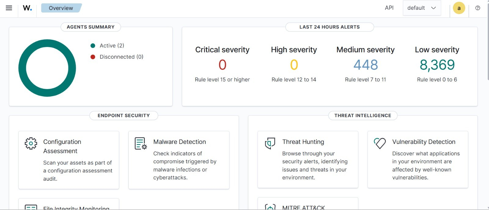
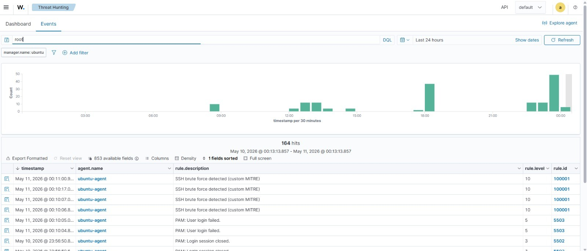
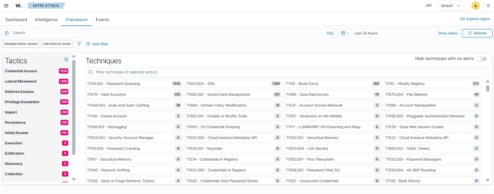
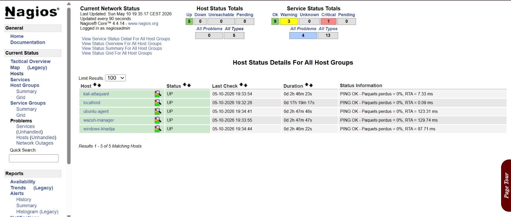

# SOC Wazuh & Nagios

Conception et déploiement d'un SOC académique 100 % open source : **Wazuh** (SIEM) pour la détection et la réponse, **Nagios Core** pour la supervision de l'infrastructure, avec des scénarios d'attaque mappés sur **MITRE ATT&CK**.

> Projet de fin d'année (PFA), 4e année cycle ingénieur, spécialité Cybersécurité et Infrastructure Réseau, EMSI Casablanca, 2025-2026.
> Environnement de laboratoire, à des fins pédagogiques uniquement.

## Objectif

Montrer qu'on peut monter un SOC fonctionnel sans licence, qui couvre deux choses souvent séparées :

- **la sécurité** : collecte de logs, détection d'attaques, corrélation, réponse automatique (Wazuh) ;
- **la santé de l'infrastructure** : disponibilité des machines, services critiques, charge (Nagios).

L'idée : un SOC qui ne surveille pas ses propres composants peut perdre de la visibilité sans que personne ne s'en rende compte.

## Architecture

Lab réparti sur deux postes physiques, relié par **Tailscale** (WireGuard) pour avoir des adresses stables malgré des réseaux Wi-Fi différents et du NAT opérateur.

| Composant | Rôle |
|---|---|
| VM Wazuh (Ubuntu 22.04) | Manager + Indexer (OpenSearch) + Dashboard, déploiement tout-en-un |
| VM Ubuntu Agent | Cible Linux, agent Wazuh (auth.log, syslog, iptables) |
| VM Nagios (Ubuntu 22.04) | Nagios Core 4.4 + NRPE, supervision des hôtes et services |
| VM Kali Linux | Machine attaquante (Hydra, Nmap) |
| Endpoint Windows 11 | Agent Wazuh sur un poste réel (événements Windows) |

Flux : agents Wazuh → Manager (port 1514, TLS) → Indexer → Dashboard ; Nagios surveille les hôtes (ping), les ports Wazuh (1514, 9200, 55000, 443) et les ressources via NRPE.

## Captures

Tableau de bord Wazuh, 2 agents actifs :

Détection du brute force SSH par une règle personnalisée (règle 100001, niveau 10) :

Alertes mappées sur MITRE ATT&CK :

Supervision Nagios des hôtes du lab :

## Outils

Wazuh · OpenSearch · Nagios Core · NRPE · VMware Workstation · Tailscale · Kali Linux · Hydra · Nmap · Ubuntu 22.04 · HTML/CSS/JS (dashboard)

## Scénarios d'attaque

Simulés depuis Kali contre la cible Ubuntu et détectés par Wazuh :

| Technique MITRE ATT&CK | Scénario | Outil |
|---|---|---|
| T1110.001 Password Guessing | Brute force SSH | Hydra |
| T1046 Network Service Discovery | Scan de ports | Nmap |
| T1548.003 Sudo and Sudo Caching | Abus de sudo | manuel |
| T1078 Valid Accounts | Tentatives de connexion root SSH | SSH |
| T1136 Create Account | Création d'un compte suspect | adduser |
| T1565.001 Stored Data Manipulation | Modification de fichiers critiques (FIM) | manuel |

## Résultats observés

Alertes générées pendant les tests (extraites du dashboard du projet) :

| Technique | Alertes |
|---|---|
| T1110.001 Brute force SSH | 1 544 |
| T1078 Connexion root SSH | 252 |
| T1565.001 Modification de fichiers critiques | 251 |
| T1548.003 Abus de sudo | 36 |
| T1136 Création de compte | 2 |

La réponse automatique (Active Response, script `firewall-drop`) bloque l'IP source via iptables. Objectif de conception : blocage en moins de 30 secondes.

## Dashboard

[`dashboard/soc-dashboard.html`](dashboard/soc-dashboard.html) : page HTML autonome qui regroupe l'état de Wazuh et de Nagios, les techniques ATT&CK détectées, la chronologie des attaques et une page de configuration des notifications. Les adresses IP et l'email ont été remplacés par des valeurs d'exemple.

## Limites

- Lab de petite taille, non représentatif d'une production.
- Wazuh déployé en tout-en-un sur une seule VM (choix de ressources, pas d'architecture de production).
- Pas de SOAR avancé : l'Active Response joue un rôle simplifié.

## Perspectives

Intégration d'un SOAR (TheHive, Cortex), analyse forensic de niveau L3, règles de détection supplémentaires.

## Équipe

Projet réalisé en binôme :

- **Aya El Jemli** : architecture, infrastructure, déploiement Wazuh
- **Khadija Sekkat** : coordination, Blue Team, Active Response, Nagios

Encadrant académique : Pr. Zouhair Chiba (EMSI).
